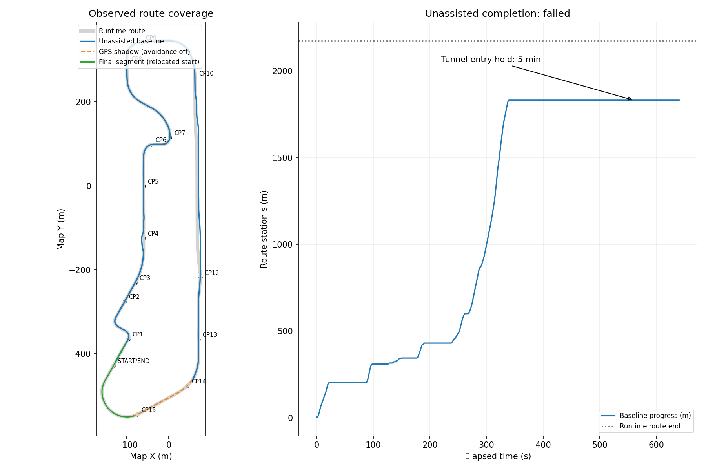

# MORAI 전체 코스 현장 점검 — 2026-10-16

## 목적과 진행 기준

중간점검 제출 이후 사용자가 실제 주행을 명시적으로 승인했다.
현재 원본 코드로 완주 가능 여부를 확인하고, 실제로 실패한 구간과 미검증 구간을 기록한다.
목표는 문제 목록과 재현 자료 확보이며 production 알고리즘·경로·미션·신호 ROI는 변경하지 않는다.
브랜치 `run/ros1-update-20261016`, HEAD `2d34dc2`.

영향 파일은 이 문서와 Git 제외 `docker/artifacts/fullcourse-20261016/`의 관측 도구·자료다.
기존 제출 영상, 과거 bag·검증 기록, 원본 비교 프로젝트는 보존한다.

검증은 센서/차량 상태 확인 → 실제 제어 주행 → 화면·원본 영상·인지·목표·제어 기록 →
실패 시각/위치/직접 정지 사유 분석 → 종료 인계 확인 순서로 진행한다.
장시간 무진행·경로 이탈·충돌 또는 필수 노드 종료는 실패로 남긴다.
수동 재배치 등 개입을 하게 되면 별도 구간 시험으로 표시하며 무개입 완주로 세지 않는다.

완료 기준은 완주 여부와 근거, 확인된 실패 목록, 도달하지 못해 미검증인 미션,
재현 가능한 실행 명령 및 모든 자체 주행·녹화 프로세스의 종료 기록이다.

## 진행 기록

- 기존 주행/녹화 프로세스 없음, MORAI와 WeatherTimeChanger 실행 중.
- 시작 화면 차량 정지/P, 필수 UDP6초 검사 전 채널 수신·파싱 오류0.
- 실제 주행 및 최종 결과는 아래에 이어 기록한다.

## 최종 판정

**원본 코드의 무개입 전체 완주는 실패했다.** 시작점 근처 s5.01m부터 약1,831.81m까지
진행한 뒤 터널 진입 전 정지했고, 5분 동안 회복되지 않았다. 같은 위치에서 노드를
재시작해도 약7m만 더 진행한 후 다시 정지했다. 정적 장애물 회피에서는 로컬 위치 기준
CP4의 반경3m 조건도 놓쳤다.

끝까지 확인하기 위해 별도 구간 시험을 추가했다. 터널 이후에 자차를 재배치한 시험에서는
END를 지나 follower의 `FINISH`까지 도달했다. 회피를 끈 별도10km/h 시험에서는
터널 GPS 음영 구간의 `GPS → DR → GPS` 복귀를 확인했다.
이 두 결과를 합쳐 무개입 완주나 터널 회피 성공으로 집계하지 않는다.



## 실제 시험 목록

아래 s는 경로상 후륜축 진행거리다. 초기 위치가 없는 WAITING 행의0은 실제 위치로 집계하지 않았다.
각 시험의 launch 및 bag recorder는 종료코드0으로 종료했다.

| 폴더 | 설정·개입 | 관측 결과 |
| --- | --- | --- |
| `baseline` | 원본 전체 로직, 위치/제어 개입 없음 | s5.01→1831.81m. 터널 앞 약300.55초 정지. 5분 무진행 기준 종료 |
| `restart-same-position` | 같은 위치에서 원본 노드 새 기동 | s1831.75→1838.62m. 다시 PLANNER HOLD. 65초 시험 한도 종료 |
| `ASSIST-to-1870` | 회피 상태 제외, follower10km/h, 별도 이동 | s1838.62→1870.20m. 이후 원본 전체 로직으로 복귀 |
| `tunnel-interior` | 위 이동 후 원본 전체 로직 새 기동 | GPS 음영에서 위치 초기화 불가. 75초 WAITING, 주행 진행 없음 |
| `final-segment` | 자차만 s1995m 부근으로 재배치, 원본 전체 로직 | s1995.68→2234.55m. END 통과 후 runout 끝 FINISH 정지 |
| `ASSIST-gps-shadow` | 자차를 s1830m에 재배치, 회피 상태 제외, follower10km/h | s1830.97→2006.73m. GPS→DR→GPS, 목표 위치 도달 후 종료 |

보조 이동은 Git 제외 `assist-position.launch`로만 실행했다. 원본 production 파일·신호 정책·
watchdog·경로·미션·ROI는 수정하지 않았다. 원본 전체 로직 시험은 항상 `docker/local.launch`다.
자차 재배치용 시나리오는 공식 파일의 사본에서 ego 초기 위치·방향만 변경했고,
GUI에서 Ego Vehicle Data만 로드했다. 다른 객체와 센서의 로드는 해제했다.
모든 개입은 원본 시험 종료 후 별도 시험 사이에 수행했다.

## 확인된 문제 목록

| 우선순위 | 문제 | 실제 증거·재현 위치 | 영향 |
| --- | --- | --- | --- |
| P0 | 터널 진입 전 회피 계획이 정지 상태에서 회복되지 않음 | s1831.75m, 좌/우 `HITS BOX / OFF ROAD`, `BEV STOP: PLANNER HOLD`; 5분 정지. 새 노드에서도 s1838.62m 재정지 | 무개입 완주 차단 |
| P0 | 장애물 회피 후 CP4 통과 반경 누락 | CP4와 기록 궤적의 최소 XY 거리4.9596m; 요구 반경3m | 완주 조건 불충족 가능. 공식 채점 대신 로컬 위치 기반 계산 |
| P1 | 회피 계산 중 target 발행 중단 | s309–345m 부근, 최대27.745초 공백. NO_TARGET893행/20Hz, 약44.65초 | 반복 제동·재출발, 진행 지연 |
| P1 | 오래된 입력으로 계산한 결과를 새 목표처럼 발행 | GO 결정의 보고 age0.0584초, 실제 bag 시각과의 추가 차이8.5636초 | 오래된 신호·위치에 의존하는 계획이 새 stamp로 보임 |
| P1 | 플래너 지연이 카메라 추론까지 끊음 | 8.583초 target 공백 동안 원본 영상255장, 검출 debug14장. gate heartbeat가0.5초 넘게 끊기면 YOLO 입력 차단 | 신호가 바뀌는 동안 최신 인식 확보가 어려움 |
| P2 | GPS 음영 안에서 새 기동하면 위치 초기화 불가 | s1870m 부근: GPS746개·Status2376개 수신, odometry/target0개, WAITING75초 | 터널 안에서 노드만 재시작해 복구할 수 없음 |
| P2 | 자차 시나리오 재로드가 제어·상태 연결 해제 | Network Data 로드를 해제해도 Ego 연결 해제. 직후 Status0, GPS/IMU/LiDAR/Camera 정상; Connect 후 Status 복구 | 센서 화면만 보고 준비 완료로 판단하면 주행 시작 실패 |

P0/P1은 이번 기록에서 실제 실패가 관측됐다. P2 두 항목은 운용 제약이다.
GPS 음영에서의 초기화 불가는 위치 기준점 없이 DR을 시작하지 않는 기존 동작이며,
연속 주행 중 DR 실패와 구분한다. 무조건 위치를 만들어 내도록 바꾸는 해결을 제안하지 않는다.

### 터널 정지의 입력 경계

종료 전 target은 `AVOID`, `v_max=0`, offset0, chain 없음이었다.
앞축 stop_s는1843.2825m, 후륜 위치는1831.7545m였다.
신호 제약은 없고 target은 계속 발행됐다. LiDAR scan age는 약0.04–0.06초였다.
따라서 이 구간의 정지를 센서 연결 끊김이나 NO_TARGET로 설명할 수 없다.

정지 중 footprint15개가 OBSTACLE로 남았고, 높이는 약0.526–0.752m였다.
가까운 작은 조각의 예는 s1843.65m/d[-1.59,-1.48], s1843.42m/d[1.90,2.01]이다.
중앙 쪽 조각도 s1862.0m/d[0.24,0.44]에 있었다. 후보 마커는 좌우 모두 차단을 표시했다.

원시 점군7,525점의 별도 정적 snapshot에서 다음을 확인했다.

- 코드의 장착 변환을 적용한 전방 아스팔트 후보647점의 높이 중앙값0.5288m.
- 차선 도색 intensity 범위 후보31점의 높이 중앙값0.5378m.
- 기존 `estimate_ground_plane` 결과None.
- 위 도색31점 전부 높이0.4m 이상이어서 기존 도색 제거 조건을 통과하지 못함.

이는 바닥·도색이 장애물로 남을 수 있는 직접적인 입력 근거다.
지면 추정은 평면 절편 절댓값0.25m 초과를 거부하므로 현재 높이 기준과 맞지 않을 수 있다.
실제 LiDAR 장착값과 코드 TF의 수치 차이는 기존에도 발견됐지만,
MORAI 차량 원점↔후륜축/base_link 변환은 아직 확인되지 않았다.
**정확한 보정값과 모든 footprint의 실제 물체 대응은 미확정이다.**
지면 높이/센서 좌표와 후보 도로 검사 경계를 먼저 재현해야 하며 임계값을 바꾸지 않았다.
오프라인 높이 민감도 실험은 런타임 수정이나 해결 검증으로 집계하지 않는다.

근거: `baseline/tunnel-stop-snapshot.json`, `tunnel-footprint-projections.json`,
`tunnel-cloud.npz`, `tunnel-ground-diagnostic.json`.

### CP4 누락과 체크포인트 확인

`routes/checkpoints.txt`의 반경3m 조건을 기준으로 follower CSV의20Hz XY와 거리 계산을 했다.
CP4는 (-59.8847,-124.5575)이며 가장 가까웠던 시점은 주행 약177.55초/s345.49m,
거리4.9596m였다. 이 근처 경로 횡거리 최대값은5.1673m였다.
회피 offset이 크다는 사실만으로 도로 이탈을 판정하지 않고, CP4 거리 조건의 누락을 문제로 기록한다.

| 체크포인트 | 원본 무개입 시험의 최소거리(m) | 판단 |
| --- | ---: | --- |
| CP1 / CP2 / CP3 | 0.358 / 0.186 / 0.254 | 로컬 궤적 기준 반경 안 |
| CP4 | 4.960 | 반경 밖 |
| CP5 / CP6 / CP7 | 0.119 / 0.300 / 0.148 | 반경 안 |
| CP8 / CP9 / CP10 | 0.052 / 0.137 / 0.095 | 반경 안 |
| CP12 / CP13 | 0.879 / 0.090 | 반경 안 |
| CP14 / CP15 / END | 미도달 | 원본 완주 실패 |

별도 보조 GPS 시험에서는 CP14/15를0.039/0.092m로 통과했고,
마지막 구간 시험에서는 END를0.288m로 통과했다. 이 거리는 별도 시험의 결과다.
GPS 장착점·후륜축·공식 Ego 위치 차이는 최종 좌표 검증 대상으로 남아 있으므로 공식 채점 결과는 아니다.
첫 원본 시험은 이미 s5.01m에 정지해 있던 상태에서 시작했으며 START 반경 통과 자체도 기록하지 않았다.

### 계산 지연·시간·카메라 의존성

원본 첫 영상 및 이전 롤백 실행의 최대73.608/98.545초 지연은
[앞선 분석](ROLLBACK_STOP_ANALYSIS_2026-10-16.md)에 보존한다.
이번 최대 지연은27.745초로 달랐지만 같은 NO_TARGET 정지가 재현됐다.

`behavior_node.py`의 tick 시작 시각 `ctx.now`로 신호 age를 계산하고,
계산 완료 시각으로 DrivingTarget stamp를 넣는 경계는 그대로다.
이번에는 실제 관측 후 약8.622초가 지난 GO를 age0.0584초로 보고했다.

카메라 노드의 `enabled()`는 `/behavior/signal_camera` heartbeat가0.5초 이내일 때만
입력을 처리한다. 느린 planning tick이 이 heartbeat도 막는다.
원본 JPEG가 계속 들어와도 추론이 오래 중단될 수 있으므로 카메라와 플래너 지연을 함께 봐야 한다.
이번에는 네 교차로 모두 해제 신호를 관측하고 통과했다. 앞선 화면 녹색/인지 red의
지속 현상이 항상 재현된 것은 아니며, 모델·ROI 자체 오분류 원인은 여전히 별도 대조가 필요하다.

## 확인된 기능과 검증 한계

| 구간·기능 | 이번 확인 범위 | 남은 제한 |
| --- | --- | --- |
| 센서·위치·제어 handshake | 사전 drive=false 검증 PASS, 제어 UDP0. 실제 주행에서 Auto/D 진입 | 장착 좌표의 정확한 동등성 미확인 |
| 네 교차로 | STOP/GO 및 정지 후 재출발 관측. 좌회전 red_left 해제 관측 | 모든 날씨·신호 위상에서 규정 준수 증명 아님 |
| 정적 장애물 | AVOID 활성화, 장애물 이후 구간까지 진행 | target 공백과 CP4 누락 발생. 무충돌 공식 판정 미확인 |
| 보행자 | YIELD 상태 관측, 보행자 미션 구간을 통과 | 실제 보행자와 모든 오검출의 구분·횡단 타이밍 적합성 미판정 |
| 회전교차로 | WAIT→ENTER→CRUISE와 구간 통과 관측 | 모든 NPC 간격·진입 우선권 조합 미검증 |
| 고속 구간 | WAIT_GAP/CHANGE/SETTLE/FOLLOW/REJOIN 관측, 구간 통과 | 최고 약122.97km/h는 속도 제한 예외 구간. 모든 차간거리 안전성 미검증 |
| 터널 회피 | 진입 전 장기 정지 재현 | 원본 회피로 터널 통과 실패 |
| GPS 음영 연속 주행 | 보조10km/h 시험에서 s1873.06m 부근 DR, s1989.94m 부근 GPS 복귀. DR 약42초, 경로 횡거리 최대0.276m | 회피 제외 시험이며 고속 DR·충돌 회피 검증 아님. 횡거리는 위치 추정 절대오차와 다름 |
| 마지막 곡선·END·정지 | 재배치 시작 시험에서 END 통과, runout 끝 s2234.55m의 FINISH/속도 약0 | 무개입 전체 완주로 해석하지 않음 |
| 종료 인계 | 각 실행의 `shutdown handoff confirmed: Manual/P, brake released` 및 launch 종료0 | 외부 강제 종료·통신 상실 시나리오는 추가 주행하지 않음 |

이번은 sample_scene 한 조건에서 가능한 현장 시험이다. 모든 미션 배치·날씨 조합을
망라한 인증 시험이 아니며, 충돌 정답 채널과 공식 채점 결과는 기록하지 않았다.
원본·검출 JPEG, LiDAR, 인지·계획·제어 bag은 각 시험에 보존했다.

화면 녹화는 **처음383.534초만 보존**됐다. ffmpeg 실행 결과는255이고 조기 종료 원인은
로그만으로 확정하지 못했다. `screen-partial.mp4`는 해당 MKV의 remux이며 전체 점검 영상이 아니다.
앞부분에는 IDE 화면도 포함돼 제출 영상으로 사용하지 않는다.
후속 구간의 판단은 bag·CSV·저장 JPEG와 별도 스크린샷에 근거한다.
기존 제출 CTRL.mp4와 CTRL_sensor.json은 변경하지 않았다.

추가 정적 검토에서 HUD의 `finish_s=2155.33`이 실제 경로 끝2174.55m보다 약19.22m
앞인 점도 확인했다. 이번 무개입 실행은 거기까지 도달하지 못했으므로 HUD의 조기 완주 표시는
실제 재현하지 않았다. HUD 기록은 CP 반경·충돌 판정을 포함하지 않아 공식 완주 근거로 쓰지 않는다.

## 자료 위치·재현

모든 원시 자료의 루트는 다음과 같다.

```text
/home/foscar/RMT-ros1/ros1-port/docker/artifacts/fullcourse-20261016/
```

- `csv-analysis.json`, `bag-analysis.json`: 실행별 위치·속도·정지·인지 상태·target 공백 요약.
- `source-audit.json`: 주요 소스·경로·미션·신호 설정의 해시와 HEAD 일치 결과.
- 각 실행 폴더: `trial-settings.json`, `launch.log`, `recorder.log`, `status.json`,
  `timeline.jsonl`, `end.json`, `diagnostics_*.bag`, `frames/`, `home/foscar_logs/`.
- `coverage.png`: 실제 진행 범위와 원본 시험의 진행거리 그래프.
- `ASSIST-*.json`, `assist-position.launch`: 위치 재배치 및 보조 시험 설정. 원본 파일과 구분.
- `restored-sample-udp.json`: 종료 후 원본 장면 복원 및 연결 확인.

원본 실행은 사용자의 실제 제어 승인 범위에서 다음과 같이 수행했다.

```bash
bash ros1-port/docker/run.sh --receive-root bash -c '
  rmt_audit=/workspace/ros1-port/docker/artifacts/fullcourse-20261016/baseline
  export HOME="$rmt_audit/home"
  export ROS_HOME="$HOME/.ros"
  export ROS_LOG_DIR="$ROS_HOME/log"
  exec python3 docker/artifacts/fullcourse-20261016/run_audit.py
'
```

위 경로에는 이미 이번 자료가 있으므로 다시 실행할 때는 새 출력 폴더를 사용해야 한다.
관측 도구는 unchanged `roslaunch docker/local.launch drive:=true bag:=false`를 기동하고
별도 rosbag으로 원본 센서까지 기록한다. 기본5분 무진행/최대25분 한도를 적용했다.
분석은 `build_report.py`(호스트), `analyze_bags.py`(native rosbag 환경)로 수행했다.
이 분석 도구들은 제어를 송신하지 않는다.

## 정리 및 다음 수정 순서

production diff0, 원본 비교 프로젝트 보존, commit/push/merge 없음.
원본 sample_scene 시작 상태와 P 및 기존 네트워크 연결을 복원했다.
자체 주행·기록 프로세스는 모두 종료했고 MORAI와 WeatherTimeChanger는 유지한다.

다음 수정은 ① 센서/차량 좌표와 지면 입력 확인 → 터널 정지 재현,
② 회피 계획에 CP4 통과 조건 검증, ③ 계산 시간 상한과 오래된 결과 발행 경계,
④ planning 지연에 묶인 카메라 gate 처리 순서가 우선이다.
각 항목은 원인 경계를 확보한 뒤 별도 수정·검증해야 한다. 이번에는 해결했다고 주장하지 않는다.
